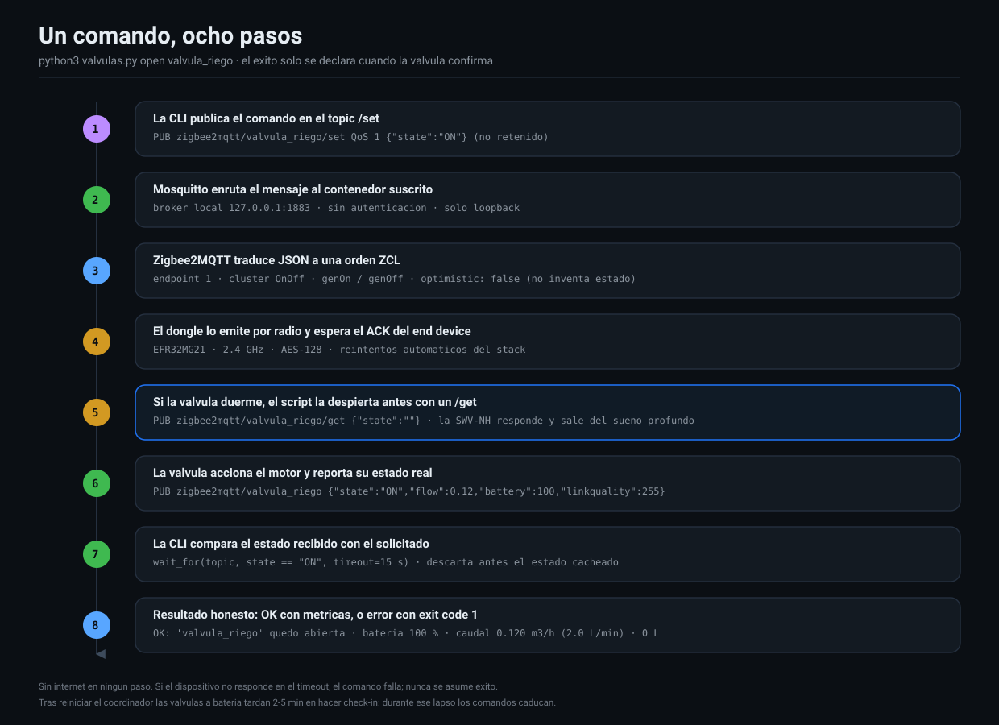
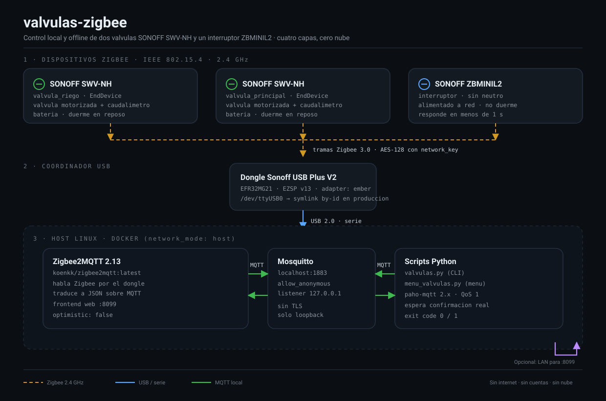
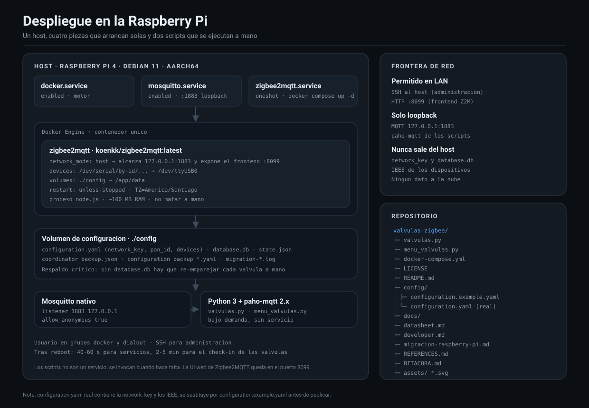

# valvulas-zigbee

**Riego por válvulas Zigbee, controlado desde tu propia red. Sin nube, sin app, sin cuenta.**

[](https://www.python.org/)
[](https://pypi.org/project/paho-mqtt/)
[](https://www.zigbee2mqtt.io/)
[](https://docs.docker.com/compose/)
[](https://mqtt.org/)
[](#seguridad-y-privacidad)
[](LICENSE)

---

## Tabla de contenido

- [Qué es](#qué-es-este-proyecto) · [El problema](#el-problema-que-resuelve) · [Principio de funcionamiento](#principio-de-funcionamiento)
- [Arquitectura](#arquitectura) · [Hardware](#hardware) · [Requisitos](#requisitos)
- [Puesta en marcha](#puesta-en-marcha-con-docker) · [Emparejamiento](#emparejamiento-físico) · [Renombrado](#renombrado-de-dispositivos)
- [CLI](#cli-completa-valvulaspy) · [Menú](#menú-interactivo-menu_valvulaspy) · [Caudal y batería](#lectura-de-caudal-volumen-y-batería)
- [Automatización](#automatización) · [Seguridad](#seguridad-y-privacidad) · [Rendimiento](#rendimiento-y-consumo)
- [Problemas](#solución-de-problemas) · [Limitaciones](#limitaciones-conocidas) · [Cómo se construyó](#cómo-se-construyó)
- [Estructura](#estructura-del-repositorio) · [Referencias](#referencias) · [Licencia](#licencia)

---

## Qué es este proyecto

Control **100 % local** de dos válvulas de agua inteligentes **SONOFF SWV-NH** y
un interruptor **SONOFF ZBMINIL2**, sobre hardware barato y software libre:

| Pieza | Rol |
|---|---|
| 2 × SONOFF SWV-NH | Válvula motorizada de agua con caudalímetro y batería |
| 1 × SONOFF ZBMINIL2 | Interruptor ON/OFF sin neutro, alimentado a red |
| 1 × Dongle Sonoff USB Plus V2 | Coordinador Zigbee (EFR32MG21, `ember`) |
| Zigbee2MQTT en Docker | Puente Zigbee ↔ MQTT y panel web |
| Mosquitto | Broker MQTT en `127.0.0.1:1883` |
| `valvulas.py` | CLI: descubrir, leer, abrir, cerrar, emparejar |
| `menu_valvulas.py` | Menú interactivo para el uso diario |

La idea es sencilla y difícil de encontrar en el mercado: **las válvulas de riego
baratas dependen de la nube del fabricante**. Este proyecto las arranca de ahí. La
red Zigbee, el broker MQTT, la base de datos de dispositivos y los scripts viven
en **una sola máquina**, normalmente una Raspberry Pi colgada de la red de casa. Si
se cae internet, el riego sigue funcionando. Si el fabricante cierra su servicio,
el riego sigue funcionando.

> **Resumen:** Zigbee para el aire, MQTT para el cable, Python para el criterio.

La CLI sirve para automatizar y depurar; el menú, para el uso diario sin recordar
comandos. Las dos comparten el mismo código MQTT y la misma política: **no declarar
éxito sin confirmación del dispositivo**.

---

## El problema que resuelve

### El riego manual es un olvido crónico

Una casa con dos circuitos de agua —jardín y huerto, riego general y goteo— tiene
un problema cotidiano: **hay que acordarse**. Abrir la llave, esperar cuarenta
minutos, acordarse de cerrarla. Olvidarse no es un bug cosmético: es agua
corriendo durante horas, una factura incómoda y, en el peor caso, un socavón junto
a los cimientos.

Los temporizadores de grifo comerciales resuelven el "acordarse" pero no el
"enterarse": son cajas ciegas. No saben si el agua pasó de verdad, no saben
cuánta, no avisan si el circuito se quedó sin presión, y su programación se edita
con tres botones y una pantalla de siete segmentos.

### Las válvulas "smart" resolvieron la mitad y crearon otra dependencia

La SONOFF SWV-NH es exactamente lo que hacía falta a nivel de hardware: válvula de
bola motorizada con **caudalímetro integrado**, batería y radio Zigbee 3.0. Mide
litros, sabe cuánto lleva regado hoy, informa su batería.

El problema es el camino oficial para usarla: la app del fabricante, una cuenta en
la nube, un servidor a miles de kilómetros. Ese modelo tiene tres costes que este
proyecto rechaza:

1. **Dependencia.** Sin nube, la válvula no obedece. Un corte de internet en casa
   es un corte de riego.
2. **Privacidad.** Los patrones de consumo de agua de un hogar son datos
   personales: cuándo riegas, cuánta agua usas, si estás de viaje.
3. **Longevidad.** El dispositivo puede durar diez años; el servicio en la nube,
   probablemente no.

### Lo que hace este repositorio

Toma el hardware, **no lo flashea** (no hace falta: es Zigbee estándar) y lo
conecta a un coordinador propio. A partir de ahí toda la inteligencia es local y
auditable: dos archivos Python de menos de 700 líneas en total, un
`docker-compose.yml` de 17 líneas y un YAML de configuración.

Con eso consigues:

- Saber el **estado real** de cada válvula, no el que debería tener.
- Abrir y cerrar con **confirmación del dispositivo**, no con un `OK` optimista.
- Leer **caudal (m³/h y L/min), litros de la sesión, litros del día y batería**.
- Emparejar dispositivos desde la propia CLI (`permit_join` por MQTT).
- Automatizar con `cron`, `systemd` o MQTT directo.

---

## Principio de funcionamiento

Cuatro capas. Ninguna habla con internet. Entenderlas explica por qué el sistema se
comporta como se comporta —incluidos sus fallos más frecuentes, que casi siempre
son de radio y no de software—.

```
┌──────────────────────────────────────────────────────────────────────┐
│  1. Radio Zigbee 3.0 · IEEE 802.15.4 · 2.4 GHz · malla y end devices │
├──────────────────────────────────────────────────────────────────────┤
│  2. Coordinador USB (EFR32MG21, EZSP v13) → /dev/ttyUSB0             │
├──────────────────────────────────────────────────────────────────────┤
│  3. Zigbee2MQTT (Docker) · traduce Zigbee ↔ JSON                     │
├──────────────────────────────────────────────────────────────────────┤
│  4. Mosquitto local · paho-mqtt · valvulas.py / menu_valvulas.py     │
└──────────────────────────────────────────────────────────────────────┘
```

### Capa 1 — Radio Zigbee

Zigbee corre sobre **IEEE 802.15.4** en **2.4 GHz**, la misma banda que el WiFi (de
ahí la mitad de los problemas). No usa IP: los nodos se identifican por una
dirección **IEEE** de 64 bits y una **NWK** de 16 bits. El **coordinador** crea y
gobierna la red (aquí el dongle, y solo puede haber uno); los **end devices** son
nodos finales, normalmente a batería, que **duermen** y solo despiertan para
reportar o recoger lo que el coordinador les guardó.

La SWV-NH es un **end device a batería**: ese detalle explica el 80 % de los errores
que verás y por qué el código despierta antes de comandar. El tráfico va cifrado con
**AES-128** usando la `network_key`, el secreto más importante del despliegue. Vive
en `config/configuration.yaml` y **no se publica**: el repositorio incluye
`configuration.example.yaml` con placeholders.

### Capa 2 — El coordinador USB

El dongle Sonoff USB Plus V2 lleva un **EFR32MG21**. Linux lo expone como puerto
serie (`/dev/ttyUSB0`, chip CP210x) y Zigbee2MQTT habla con él por **EZSP**
(`adapter: ember`). El dongle forma la red la primera vez y guarda la tabla de
vecinos en `database.db` (más `coordinator_backup.json`).

Consecuencia práctica: **`database.db` + `configuration.yaml` son la red**. Si los
pierdes, hay que re-emparejar cada válvula pulsando su botón físico: es el único
punto donde un `rm` cuesta media hora de trabajo manual.

### Capa 3 — Zigbee2MQTT traduce

Zigbee2MQTT es una aplicación Node.js en un contenedor. Convierte el mundo Zigbee en
algo que cualquier lenguaje puede consumir: **JSON sobre MQTT**. Cada dispositivo
tiene un `friendly_name` (el nombre que tú eliges), publica su estado en un topic
propio y acepta comandos en el sub-topic `/set`:

```
zigbee2mqtt/valvula_riego       →  {"state":"OFF","battery":100,"linkquality":255}
zigbee2mqtt/valvula_riego/set   ←  {"state":"ON"}
```

La traducción la hace un *converter* del modelo (`SWV` para la válvula, `ZBMINIL2`
para el interruptor). Por eso los nombres de los campos (`flow`,
`real_time_irrigation_volume`, `valve_work_state`) no los inventa este proyecto: los
define Zigbee2MQTT y aquí solo se consumen.

Una opción de configuración es la piedra angular de todo:

```yaml
device_options:
  optimistic: false
```

Con `optimistic: true`, Zigbee2MQTT publica el estado que *espera* tras un comando,
aunque el dispositivo no haya contestado. Eso hace que un script "funcione" en el
papel y falle en la realidad. Con `false`, en el topic solo aparece **lo que el
dispositivo reportó de verdad**. Por eso este proyecto puede prometer confirmación
real sin mentir.

### Capa 4 — MQTT y Python

MQTT es publish/subscribe, ligerísimo, pensado para dispositivos pequeños. Un
**broker** (Mosquitto) enruta mensajes por **topics** jerárquicos. Aquí todo ocurre
en `127.0.0.1:1883`: el broker escucha **solo en loopback**, así que nada de MQTT
sale de la máquina.

Los scripts usan `paho-mqtt` 2.x (`CallbackAPIVersion.VERSION2`), QoS 1 y una
estrategia deliberadamente simple:

1. Suscribirse al topic de estado del dispositivo.
2. **Descartar** el valor cacheado (podría ser de hace horas).
3. Publicar el comando.
4. Esperar, con timeout, un payload cuyo `state` sea **exactamente** el pedido.
5. Si no llega: error y exit code 1. Si llega: `OK` y métricas.

No hay reintentos infinitos, ni colas, ni estado persistente. Abrir una válvula ya
abierta termina en `OK` porque el dispositivo confirma `ON`: la operación es
idempotente en el sentido útil.

### El detalle que lo hace fiable: confirmación real



El paso crítico es el **despertar previo**. Sin él, un `set` enviado a una válvula en
sueño profundo caduca con el timeout ZCL de 10 s y el comando falla de forma
intermitente y desconcertante. **Despertar primero, comandar después** convirtió un
sistema "a veces sí, a veces no" en uno que responde siempre que haya radio.

---

## Arquitectura



*Dispositivos → coordinador → Zigbee2MQTT → Mosquitto → scripts.*

### Decisiones de arquitectura y por qué

| Decisión | Alternativa descartada | Motivo |
|---|---|---|
| Zigbee2MQTT en Docker | Instalación nativa con npm/systemd | Aislar la app Node.js, actualizar con `docker compose pull`, no ensuciar el host |
| `network_mode: host` | Publicar puertos con `-p` | El contenedor alcanza `127.0.0.1:1883` sin cambios y el frontend queda accesible |
| Mosquitto del sistema | Mosquitto en otro contenedor | Ya estaba instalado y en loopback: una pieza menos que mantener |
| MQTT sin autenticación | Usuario/contraseña + TLS | El broker **solo escucha en loopback**; credenciales no aportan seguridad real aquí |
| `paho-mqtt` | Biblioteca Zigbee nativa (`zigpy`, `bellows`) | Hablar Zigbee directo obliga a competir con el coordinador y reimplementar converters |
| Constantes al inicio del archivo | Variables de entorno o YAML externo | Un archivo, cero configuración oculta, se lee de arriba abajo |
| Un contenedor y dos scripts | Servicio web con API REST | El caso de uso es un humano o un `cron` ejecutando un comando |

---

## Hardware

| # | Componente | Modelo | Notas |
|---|---|---|---|
| 1 | Válvula de agua Zigbee | **SONOFF SWV-NH** ×2 | Batería, caudalímetro integrado |
| 2 | Interruptor Zigbee | **SONOFF ZBMINIL2** | Sin neutro, 220 V |
| 3 | Coordinador USB | **Sonoff Zigbee 3.0 USB Dongle Plus V2** | EFR32MG21, EZSP v13, firmware 7.4.4 |
| 4 | Host | Notebook Ubuntu 24.04 / **Raspberry Pi 4** | Debian 11 aarch64 en producción |

### SONOFF SWV-NH (válvula)

Válvula de **bola motorizada** en línea, con **caudalímetro** en el cuerpo.
Alimentada por pilas, su consumo es tan bajo que la batería se mantiene al 100 %
durante meses de uso normal.

| Atributo | Unidad | Significado |
|---|---|---|
| `state` | ON/OFF | `ON` = abierta, `OFF` = cerrada |
| `flow` | m³/h | Caudal instantáneo; solo aparece con agua circulando |
| `real_time_irrigation_volume` | L | Litros de la sesión actual o última |
| `real_time_irrigation_duration` | s | Duración de esa sesión |
| `daily_irrigation_volume` | L | Litros acumulados hoy |
| `valve_work_state` | enum | `idle` (reposo) / `working` (programa interno) |
| `current_device_status` | enum | `normal_state`, `water_shortage`, `water_leakage`, … |
| `battery` | % | Carga de la batería |
| `linkquality` | 0-255 | LQI del enlace Zigbee |

Comportamiento observado: al **abrir** hace un clic audible del motor y **enciende el
LED**; al **cerrar** el LED se apaga y el motor es mucho más silencioso (cierre
asistido por muelle). No oír nada es normal: la prueba es el estado `OFF` con el
contador de duración congelado. Si el circuito no tiene presión, reporta
`water_shortage` de forma informativa y la válvula abre igual.

### SONOFF ZBMINIL2 (interruptor)

Interruptor de empotrar **sin neutro** que se alimenta a través de la carga. Va a
red, **no lleva batería y no duerme**: contesta en menos de un segundo y no necesita
la rutina de despertar. Aquí sirve de control auxiliar (bomba, luz de invernadero,
otra electroválvula). La CLI lo trata con `on` / `off`, separado de `open` / `close`
para no mezclar semánticas: una válvula no "se enciende".

### El dongle

| Dato | Valor |
|---|---|
| Chip | Silicon Labs EFR32MG21 |
| Protocolo | EZSP (adapter `ember`), versión 13 |
| Firmware | 7.4.4 (verificado funcionando) |
| Puerto | `/dev/ttyUSB0` (CP210x); en producción, symlink `by-id` |
| Permisos | usuario en grupo `dialout` |

> **Por qué el symlink `by-id`:** `/dev/ttyUSB0` depende del orden de enumeración
> USB; si conectas otra cosa, el dongle puede pasar a `ttyUSB1` y el contenedor
> arranca sin radio. Un symlink `/dev/serial/by-id/usb-Itead_Sonoff_...-if00-port0`
> es estable entre reinicios.

---

## Requisitos

| Componente | Versión probada | Imprescindible |
|---|---|---|
| Linux (Ubuntu 24.04 / Debian 11) | — | Sí |
| Docker Engine + plugin `compose` | 29.x / v2 | Sí |
| Mosquitto | 2.x | Sí |
| Python | 3.8+ (probado en 3.12) | Sí |
| `paho-mqtt` | 2.1.0 | Sí |
| Zigbee2MQTT | 2.13.0 (`koenkk/zigbee2mqtt:latest`) | Sí |

### Permisos del usuario

```bash
sudo usermod -aG docker,dialout "$USER"
# cerrar y reabrir la sesión para que los grupos se apliquen
groups | tr ' ' '\n' | grep -E 'docker|dialout'
```

`docker` para el compose sin `sudo`; `dialout` para que el contenedor pueda abrir el
puerto serie del dongle.

### Dependencia Python

Es una sola. No hay `requirements.txt` porque sería una línea; instálala así,
preferiblemente en un entorno virtual:

```bash
cd valvulas-zigbee
python3 -m venv venv
source venv/bin/activate        # Linux / macOS
pip install "paho-mqtt>=2.0"
```

En Debian/Raspberry Pi OS sin venv (PEP 668):

```bash
sudo apt install -y python3-paho-mqtt
# o: python3 -m pip install --break-system-packages "paho-mqtt>=2.0"
```

> **Windows/macOS:** los scripts son Python puro, pero el despliegue completo (dongle
> USB, contenedor con `network_mode: host`, permisos `dialout`) es específico de
> Linux. No está soportado ni probado fuera de Linux.

---

## Puesta en marcha con Docker

Desde cero. Tiempo estimado: 20 minutos, de los cuales 15 son esperar a que las
válvulas hagan check-in.

### Paso 1 — Broker MQTT en loopback

```bash
sudo apt install -y mosquitto mosquitto-clients

sudo tee /etc/mosquitto/conf.d/local.conf > /dev/null <<'EOF'
listener 1883 127.0.0.1
allow_anonymous true
EOF

sudo systemctl enable --now mosquitto
```

Comprobación:

```bash
mosquitto_sub -h 127.0.0.1 -t 'prueba/#' -v &
mosquitto_pub -h 127.0.0.1 -t 'prueba/hola' -m 'funciona'
# prueba/hola funciona
```

### Paso 2 — Configurar Zigbee2MQTT

El repositorio **no** incluye la configuración real: incluye una plantilla.

```bash
cp config/configuration.example.yaml config/configuration.yaml
```

| Clave | Qué poner |
|---|---|
| `serial.port` | `/dev/ttyUSB0` o el symlink `by-id` (recomendado) |
| `serial.adapter` | `ember` — no cambiar para el dongle Sonoff EFR32 |
| `mqtt.server` | `mqtt://localhost:1883` |
| `mqtt.base_topic` | `zigbee2mqtt` (debe coincidir con `Z2M_PREFIX`) |
| `advanced.network_key` | `GENERATE` la primera vez; **conservar** después |
| `advanced.pan_id` | `GENERATE` la primera vez; **conservar** después |
| `advanced.channel` | `11`, `15`, `20` o `25` |
| `device_options.optimistic` | `false` — **no tocar** |
| `devices` | vacío la primera vez; se rellena al emparejar |

> **Canal:** el 11 se solapa con el canal WiFi 11. Si tu router está en 1, 6 u 11 y
> las válvulas quedan lejos, prueba **15**, **20** o **25**. Cambiar de canal no
> exige re-emparejar, pero sí reiniciar el contenedor y esperar el check-in.

> **Nunca cambies `network_key` ni `pan_id` en una red ya poblada.** El coordinador
> formará una red nueva y las válvulas quedarán huérfanas: hay que resetearlas y
> emparejarlas otra vez, una por una, con su botón.

### Paso 3 — Levantar el contenedor

```bash
cd valvulas-zigbee
docker compose up -d
docker compose logs -f
```

Salida esperada la primera vez:

```
z2m: Starting Zigbee2MQTT version 2.13.0
z2m: New network formed!
z2m: Currently 0 devices are joined.
z2m: Zigbee2MQTT started!
```

En arranques posteriores, `New network formed!` se sustituye por
`Adapter network matches config.` y aparece `Currently N devices are joined.`

### Paso 4 — Interfaz web

Con `network_mode: host`, el frontend queda en el puerto **8099**:
`http://localhost:8099` (o `http://<IP-del-host>:8099` desde la LAN). Ahí puedes
inspeccionar dispositivos, ver el mapa de red, lanzar `permit_join` y renombrar.
**No tiene autenticación**: es una herramienta de administración.

### Paso 5 — Primera lectura

```bash
python3 valvulas.py list
```

Sin dispositivos emparejados:

```
Sin dispositivos emparejados todavía. Ejecuta: python3 valvulas.py pair 60
```

### Paso 6 — Persistencia al arranque

```bash
sudo systemctl enable docker mosquitto
```

La unidad `oneshot` que levanta el stack, el orden de servicios y la limpieza del
host están en [docs/migracion-raspberry-pi.md](docs/migracion-raspberry-pi.md).

---

## Emparejamiento físico

Es el único paso que **no se puede automatizar**: hay que tocar el dispositivo. La
CLI solo abre la ventana (`permit_join`).

1. **Abrir la ventana** (60 s por defecto): `python3 valvulas.py pair 60`. El script
   publica `{"value": true, "time": 60}` en
   `zigbee2mqtt/bridge/request/permit_join`, espera y publica
   `{"value": false, "time": 0}` al terminar. **Se cierra sola**: si tardas, repite.
2. **Poner el dispositivo en modo emparejamiento**: SWV-NH, mantener el botón hasta
   que el LED parpadee; ZBMINIL2, mantener el botón de reset hasta que parpadee.
3. **Esperar la entrevista** (10-30 s). En los logs:
   `Successfully interviewed '<IEEE>', device has been successfully added`.
4. **Comprobar** con `python3 valvulas.py list` y **renombrar**.

### Si la entrevista falla

| Síntoma en logs | Causa | Solución |
|---|---|---|
| `can not get node descriptor` | Señal débil durante la entrevista | Acercar el dispositivo al dongle **solo para emparejar**, luego devolverlo |
| `Interview failed` | Se durmió antes de terminar | Despertarlo con el botón y repetir `pair` |
| No aparece nada | `permit_join` expirado | Repetir `pair 120` y ser más rápido |
| `supported: false` | Converter no reconocido | `docker compose pull && docker compose up -d` |

> **Caso real:** el ZBMINIL2 emparejó al lado del dongle y falló en otra planta con
> `can not get node descriptor`. Acercarlo, emparejar y devolverlo lo resolvió en dos
> minutos: **emparejar exige mejor señal que operar**, porque hay decenas de mensajes
> seguidos.

**Reset de fábrica:** mantener el botón ~10 s hasta que el LED parpadee rápido.
Necesario si la válvula quedó atada a una red que ya no existe (por ejemplo, tras
cambiar la `network_key`).

---

## Renombrado de dispositivos

Zigbee2MQTT identifica cada dispositivo por su **IEEE**; `valvula_riego`,
`valvula_principal` e `interruptor` son `friendly_name` que tú eliges. El código
**asume** esos tres nombres.

**Opción A — UI web (recomendada):** `http://localhost:8099` → dispositivo → campo
*Name* → **Rename**.

**Opción B — por MQTT:**

```bash
mosquitto_pub -h 127.0.0.1 -t 'zigbee2mqtt/bridge/request/device/rename' \
  -m '{"from":"0x00124b0000000001","to":"valvula_riego"}'
```

**Opción C — editando la config** (`devices:` → IEEE → `friendly_name`) y
reiniciando el contenedor.

| Alias en Python | `friendly_name` | Tipo |
|---|---|---|
| `valvula_riego` | `valvula_riego` | Válvula SWV-NH |
| `valvula_principal` | `valvula_principal` | Válvula SWV-NH |
| `interruptor` | `interruptor` | Interruptor ZBMINIL2 |

Si prefieres otros nombres, edita los diccionarios al inicio de `valvulas.py`:

```python
VALVULAS = {
    "jardin": "riego_jardin",       # alias CLI  →  friendly_name
    "huerto": "riego_huerto",
}
INTERRUPTORES = {
    "bomba": "bomba_patio",
}
```

`menu_valvulas.py` **hereda** esos diccionarios y renumera sus opciones solo. Si
renombras en Zigbee2MQTT y no actualizas el código, `list` te avisa:
`AVISO: No se encontraron tus válvulas por su nombre configurado.`

---

## CLI completa (`valvulas.py`)

| Comando | Argumentos | Qué hace | Exit |
|---|---|---|---|
| `list` | — | Lista dispositivos vistos por Zigbee2MQTT | 0 / 1 |
| `status` | — | Estado + caudal + volumen + batería de cada válvula | 0 / 1 |
| `open` | `NOMBRE [--timeout N]` | Abre y espera confirmación real | 0 / 1 |
| `close` | `NOMBRE [--timeout N]` | Cierra y espera confirmación real | 0 / 1 |
| `on` | `NOMBRE [--timeout N]` | Enciende un interruptor y confirma | 0 / 1 |
| `off` | `NOMBRE [--timeout N]` | Apaga un interruptor y confirma | 0 / 1 |
| `read` | `NOMBRE` | Lee caudal, litros y batería **sin** cambiar estado | 0 / 1 |
| `monitor` | — | Muestra en vivo todo lo que publica Zigbee2MQTT | 0 (Ctrl+C) |
| `pair` | `[SEGUNDOS]` | Abre `permit_join` N segundos (60 por defecto) | 0 / 1 |

`--timeout` (15 s por defecto) es el tiempo máximo de espera de confirmación, **no**
el tiempo de riego: la válvula sigue abierta hasta que la cierres.

### `list` — qué hay en la red

```
$ python3 valvulas.py list
Dispositivos descubiertos por Zigbee2MQTT (4):
Nombre             IEEE                Tipo         Modelo    Soportado
-----------------  ------------------  -----------  --------  ---------
Coordinator        0x0000000000000000  Coordinator  -         True
valvula_riego      0x0000000000000001  EndDevice    SWV       True
valvula_principal  0x0000000000000002  EndDevice    SWV       True
interruptor        0x0000000000000003  EndDevice    ZBMINIL2  True
```

Lee el topic **retenido** `zigbee2mqtt/bridge/devices`, así que responde al
instante. Los IEEE de la tabla son placeholders. El coordinador aparece como un
dispositivo más: es normal.

### `status` — estado forzando lectura

```
$ python3 valvulas.py status
Válvula            Estado  Caudal (m³/h)  Vol. riego (L)  Dur. riego (s)  Vol. diario (L)  Modo válvula  Batería (%)  Señal
-----------------  ------  -------------  --------------  --------------  ---------------  ------------  -----------  -----
valvula_riego      OFF     -              0               0               0                idle          100          255
valvula_principal  OFF     -              0               0               0                idle          100          255
```

Por cada válvula: se suscribe, **descarta** el valor cacheado y envía un `get` para
obligarla a responder (hasta 20 s por válvula). Si alguna no contesta, la fila dice
`NO DISPONIBLE` y el exit code es **1**: el fallo no se disimula.

### `open` / `close` — con confirmación

```
$ python3 valvulas.py open valvula_riego
Comando ON enviado a 'valvula_riego' (valvula_riego). Esperando confirmación real...
OK: 'valvula_riego' quedó abierta (confirmado por el dispositivo).
   Abierta: empieza a medir caudal y volumen.
   Medición:
     Batería      : 100 %
     Caudal       : 0.120 m³/h  (2.0 L/min)
     Vol. sesión  : 0 L
     Duración     : 0 s
     Vol. de hoy  : 0 L
```

Fallo honesto (`--timeout 5`): `ERROR: timeout de 5s esperando el estado real de
'valvula_riego'.` seguido de pistas (logs del contenedor, check-in pendiente). Y
validación previa, sin tocar la radio: `ERROR: válvula desconocida '...'. Válvulas
configuradas: valvula_riego, valvula_principal`. Si falta el argumento, `argparse`
responde en inglés con exit code **2**.

### `read` — medir sin tocar nada

```
$ python3 valvulas.py read valvula_riego

  Válvula: valvula_riego
  Estado : ON
  Lectura en vivo:
     Batería      : 98 %
     Caudal       : 0.450 m³/h  (7.5 L/min)
     Vol. sesión  : 12 L
     Duración     : 95 s
     Vol. de hoy  : 12 L
```

Para "¿cómo va el riego?" sin riesgo: `watch -n 30 'python3 valvulas.py read valvula_riego'`.

### `monitor` — el microscopio

Suscribe a `zigbee2mqtt/#` y muestra **todo** con marca de tiempo: bridge,
dispositivos, respuestas de `set`, disponibilidad. Si algo no aparece aquí, no llegó
al broker. `Ctrl+C` para salir.

### `pair` — ventana de emparejamiento

Zigbee2MQTT 2.x **exige** el campo `time`; enviar solo `{"value": true}` deja
`permit_join` indefinidamente activo o falla según versión. `valvulas.py pair N`
manda `{"value": true, "time": N}` y cierra con `{"value": false, "time": 0}`.

---

## Menú interactivo (`menu_valvulas.py`)

```bash
python3 menu_valvulas.py
```

```
==============================================
      CONTROL DE DISPOSITIVOS ZIGBEE
==============================================
   Válvulas:
     valvula_riego        : OFF
     valvula_principal    : OFF
     (ON = abierta, OFF = cerrada)

   Interruptores:
     interruptor          : OFF
     (ON = encendido, OFF = apagado)
----------------------------------------------
   [1]   Abrir  valvula_riego
   [2]   Cerrar valvula_riego
   [3]   Abrir  valvula_principal
   [4]   Cerrar valvula_principal
   [5]   Encender interruptor
   [6]   Apagar  interruptor
   [R]   Actualizar estado
   [Q]   Salir
----------------------------------------------
   Elige una opción:
```

- **Conexión persistente**: se conecta una vez y queda suscrito; cada acción es
  instantánea comparada con arrancar la CLI.
- **Estado en pantalla**, refrescado tras cada comando o con `R`.
- **Numeración dinámica**: al añadir una válvula a `VALVULAS` aparecen dos opciones
  nuevas y el resto se renumera.
- **Confirmación real** en cada acción (20 s por defecto).
- `Q`, `0` o `Ctrl+C` salen cerrando la conexión MQTT.

---

## Lectura de caudal, volumen y batería

La SWV-NH reporta **m³/h**; la CLI muestra también L/min porque m³/h es incómodo para
un grifo doméstico:

```
L/min = (m³/h × 1000) / 60
```

| m³/h | L/min | Interpretación típica |
|---|---|---|
| 0.05 | 0.8 | Goteo |
| 0.12 | 2.0 | Goteo de un circuito pequeño |
| 0.45 | 7.5 | Aspersión doméstica |
| 1.20 | 20.0 | Manguera abierta / llenado de depósito |

### Tres volúmenes que no son lo mismo

| Campo | Se reinicia… | Para qué sirve |
|---|---|---|
| `real_time_irrigation_volume` | Al iniciar una nueva sesión | Cuánto llevas en el riego actual |
| `real_time_irrigation_duration` | Idem | Cuánto tiempo lleva abierta |
| `daily_irrigation_volume` | Cada día (medianoche del dispositivo) | Detectar fugas y controlar consumo |

### Verificar que cerró de verdad

No te fíes del sonido ni del LED: la prueba es el contador. Ejecuta `read`, espera un
minuto y vuelve a ejecutarlo.

| Observación | Interpretación |
|---|---|
| `OFF` y duración idéntica | Cerrada de verdad |
| `OFF` y duración subiendo | Programa interno activo (`valve_work_state: working`) |
| `flow > 0` con `state: OFF` | Fuga o programa cíclico en marcha |
| `water_shortage` | Sin presión en esa línea: informativo |

`battery` se mantuvo en **100 %** durante semanas de uso intermitente: el consumo
real es del motor, no de la radio. Por debajo del 30 % la válvula empieza a fallar en
el cierre y en el reporte. `linkquality` (0-255) es el LQI: valores sostenidos
**< 50** anuncian comandos que caducan, entrevistas que fallan y `?` en el menú.

---

## Automatización

La CLI **es** la API. Cualquier cosa que sepa ejecutar un proceso puede regar.

### `cron`: riego diario de 20 minutos

```cron
30 6 * * * cd /home/usuario/valvulas-zigbee && venv/bin/python valvulas.py open valvula_riego >> /var/log/riego.log 2>&1
50 6 * * * cd /home/usuario/valvulas-zigbee && venv/bin/python valvulas.py close valvula_riego >> /var/log/riego.log 2>&1
```

### `systemd` timer

`/etc/systemd/system/riego.service` (un `Type=oneshot`, `User=<TU_USUARIO>`,
`WorkingDirectory=/home/<TU_USUARIO>/valvulas-zigbee` y
`ExecStart=/usr/bin/python3 valvulas.py open valvula_riego --timeout 30`) más
`riego.timer` con `OnCalendar=*-*-* 06:30:00` y `Persistent=true`. Después:

```bash
sudo systemctl enable --now riego.timer
```

### Cerrar siempre, pase lo que pase

El fallo clásico es **abrir y que el cierre no llegue** (cron que no se ejecuta,
máquina apagada, red caída):

```bash
#!/usr/bin/env bash
# riego_seguro.sh — abre, espera, cierra; si falla el cierre, insiste y deja rastro.
set -u
cd /home/usuario/valvulas-zigbee || exit 1
PY=venv/bin/python

$PY valvulas.py open valvula_riego || exit 1
sleep 1200

for intento in 1 2 3; do
    $PY valvulas.py close valvula_riego --timeout 30 && exit 0
    echo "Cierre fallido (intento $intento)" >&2
    sleep 20
done

logger -t riego "NO SE PUDO CERRAR valvula_riego"
exit 1
```

### MQTT directo (sin Python)

```bash
mosquitto_pub -h 127.0.0.1 -t zigbee2mqtt/valvula_riego/set -m '{"state":"ON"}'
mosquitto_pub -h 127.0.0.1 -t zigbee2mqtt/valvula_riego/set -m '{"state":"OFF"}'
mosquitto_sub -h 127.0.0.1 -t zigbee2mqtt/valvula_riego -v
```

Por MQTT directo **no hay confirmación**: publicar y olvidar es justo lo que este
proyecto evita. Si lo usas, verifica después con `read`.

> La SWV-NH también soporta riego cíclico por tiempo y por volumen
> (`cyclic_timed_irrigation`, `cyclic_quantitative_irrigation`). Funciona con el host
> apagado, pero no deja registro central: este proyecto no lo usa por defecto para no
> tener dos fuentes de verdad.

---

## Seguridad y privacidad

| Dato | Dónde vive | Sale a internet |
|---|---|---|
| Estado de las válvulas | Broker local + Z2M | ❌ |
| Caudal y litros | `state.json` en `./config` | ❌ |
| `network_key` Zigbee | `configuration.yaml` | ❌ |
| IEEE de tus dispositivos | `database.db` + config | ❌ |
| Horarios de riego | Tu `cron` / tus scripts | ❌ |
| Telemetría de uso | No existe | ❌ |

No hay cuenta, ni registro, ni *telemetry endpoint*. Se puede auditar con `ss -tupn`:
el contenedor solo necesita loopback.

| Elemento | Escucha en | Riesgo | Mitigación |
|---|---|---|---|
| MQTT `1883` | `127.0.0.1` | Bajo | Ya confinado a loopback; no cambiar el `listener` |
| Frontend Z2M `8099` | `0.0.0.0` | Medio | Solo LAN; desactivar (`frontend.enabled: false`) si no lo usas |
| SSH | LAN | Medio | Claves, no contraseñas; sin reenvío de puertos |
| `permit_join` abierto | — | Alto | El script lo cierra solo; verifica que quede `false` |

Reglas prácticas:

1. **Nunca publiques `config/configuration.yaml`, `state.json`, `database.db` ni los
   `configuration_backup_*.yaml`.** Contienen la network key, el PAN ID y los IEEE.
   Para eso existe `configuration.example.yaml` con placeholders.
2. **`permit_join` en `false`** salvo al emparejar. Una red abierta permite que un
   vecino con un dongle se una y comande tus válvulas.
3. **MQTT sin TLS solo es aceptable en loopback.** Si mueves el broker a otra
   máquina, activa autenticación y TLS antes de cruzar la red.
4. **Riega con supervisión y con cierre garantizado.** Este software abre una válvula
   de agua real; el frontend de Z2M no tiene login, trátalo como panel doméstico.

---

## Rendimiento y consumo

Medido en el despliegue real (Raspberry Pi 4, 2 válvulas + 1 interruptor):

| Métrica | Valor |
|---|---|
| RAM del contenedor | ~100 MB (proceso Node.js) |
| CPU en reposo | < 2 % de un núcleo |
| Comando → confirmación (despierta) | 0.5 – 2 s |
| Comando → confirmación (dormida) | 2 – 8 s (incluye el `get` de despertar) |
| `list` (topic retenido) | < 1 s |
| `status` (2 válvulas, forzando lectura) | 2 – 40 s según sueño |
| Mensaje de estado | ~200–400 bytes JSON |
| Tráfico a internet | 0 bytes |

`status` tarda porque cada válvula dormida necesita despertar, responder y volver a
dormir, y el script las atiende en serie: con dos dormidas, 40 s es el peor caso
**normal**, no un fallo. Para algo rápido: `read NOMBRE`.

| Dispositivos | Comentario |
|---|---|
| 1–30 | Territorio cómodo de un solo coordinador |
| 30–50 | Añadir routers (enchufes Zigbee) para extender la malla |
| > 50 | Considerar un segundo coordinador: el LQI y las entrevistas empeoran |

La malla la forman los dispositivos alimentados a red (el ZBMINIL2); las válvulas no enrutan.

---

## Solución de problemas

| Síntoma | Causa | Solución |
|---|---|---|
| `Coordinator failed to start` | Permisos o firmware | Verifica `dialout` y `ls -l /dev/ttyUSB0`; si persiste, flashear firmware EZSP |
| El contenedor arranca sin radio | El puerto cambió de nombre | Usar symlink `by-id` en `docker-compose.yml` |
| `permit_join` sigue activo | `time` no enviado | Usar `valvulas.py pair N` (manda `time`) |
| La válvula no empareja | Ventana expirada o red anterior | `pair 120` y, si estuvo en otra red, reset de fábrica |
| `can not get node descriptor` | Señal débil | Acercar al dongle durante la entrevista |
| `?` en el menú / `NO DISPONIBLE` | Dormida o fuera de rango | Esperar el check-in (2-5 min tras reiniciar) o pulsar su botón |
| `linkquality` < 50 sostenido | Distancia o interferencia | Acercar, añadir router Zigbee, cambiar de canal (15/20/25) |
| Comandos que caducan de noche | WiFi saturado en 2.4 GHz | Cambiar canal Zigbee; alejar el dongle del router y del USB 3.0 |
| `No se pudo conectar al broker MQTT` | Mosquitto caído | `sudo systemctl start mosquitto` |
| `Zigbee2MQTT no respondió` | Contenedor no levantado | `docker compose up -d`; `docker compose logs -f` |
| `docker compose` pide `sudo` | Usuario sin grupo | `sudo usermod -aG docker $USER` y reabrir sesión |
| No se oye nada al cerrar | Cierre asistido por muelle | Verificar `status` y el contador congelado |
| `valve_work_state: working` | Programa interno activo | Revisar la programación en la UI de Z2M |

---

## Limitaciones conocidas

Honestidad por delante, porque son decisiones y no sorpresas:

1. **No hay planificador propio.** La CLI abre y cierra; el "cuándo" lo pone `cron`,
   `systemd` o tu script. No hay base de datos de horarios ni calendario.
2. **MQTT sin autenticación.** Correcto en loopback, insuficiente si algún día mueves
   el broker a otra máquina.
3. **Un solo host.** Si la Raspberry se cae, no hay riego automático (salvo el programa
   interno de la válvula). No hay alta disponibilidad ni réplica del broker.
4. **Dependencia del `friendly_name`.** Renombrar en Zigbee2MQTT sin tocar
   `valvulas.py` rompe los comandos (con aviso en `list`, pero rompe).
5. **Sin tests automatizados.** Verificación manual contra hardware real: no hay
   `pytest`, ni mocks del broker, ni CI.
6. **Confirmación acotada por timeout.** Si la válvula responde tarde, el comando falla
   aunque el riego ocurra; y no existe "riega 20 litros y para" de fábrica (se puede
   implementar leyendo `real_time_irrigation_volume`). El frontend de Z2M queda
   expuesto en la LAN, sin login: si no lo usas, desactívalo.

---

## Cómo se construyó

Pipeline de especificación → implementación → auditoría → documentación, con dos
ciclos de corrección:

1. **Especificación primero.** Se fijaron comandos, contrato de confirmación y manejo
   de errores antes de escribir Python. El plan asumía estados `OPEN`/`CLOSE`; la
   realidad del converter `SWV` es `ON`/`OFF`, y se corrigió contra el dispositivo.
2. **Auditoría en dos ciclos.** El primero encontró cinco incidencias (entre ellas que
   `--timeout` no se propagaba y que `connect()` dejaba escapar tracebacks). El
   segundo las verificó una por una.
3. **Pruebas contra hardware real.** Los mensajes de error de este README son los que
   realmente imprime el programa.
4. **El bug que definió el diseño.** Las válvulas dormían y los comandos caducaban de
   forma intermitente. La solución —despertar con un `get` antes del `set`— se
   descubrió operando, no leyendo. Ver [docs/BITACORA.md](docs/BITACORA.md).
5. **Migración a Raspberry Pi** conservando la red Zigbee (mismo dongle, misma
   `network_key`, mismo `database.db`). Runbook en
   [docs/migracion-raspberry-pi.md](docs/migracion-raspberry-pi.md).

---

## Estructura del repositorio



- `valvulas.py` y `menu_valvulas.py` — CLI y menú interactivo.
- `docker-compose.yml` — Zigbee2MQTT (`host`, device USB, volumen `./config`).
- `config/configuration.example.yaml` — plantilla; el `configuration.yaml` real no se
  versiona.
- `docs/` — manual de operador, referencia técnica, runbook de migración, referencias,
  bitácora y los tres SVG.

Archivos de runtime que **no** deben publicarse (los cubre `.gitignore`):
`database.db`, `state.json`, `coordinator_backup.json`,
`configuration_backup_*.yaml`, `migration-*.log` y `log/`, todos bajo `config/`.

---

## Referencias

- [Zigbee2MQTT — documentación](https://www.zigbee2mqtt.io/) ·
  [SWV-NH](https://www.zigbee2mqtt.io/devices/SWV.html) ·
  [ZBMINIL2](https://www.zigbee2mqtt.io/devices/ZBMINIL2.html) ·
  [adaptadores EFR32/ember](https://www.zigbee2mqtt.io/guide/adapters/emberznet.html)
- [paho-mqtt](https://pypi.org/project/paho-mqtt/) ·
  [Mosquitto](https://mosquitto.org/documentation/) ·
  [MQTT 3.1.1 (OASIS)](https://docs.oasis-open.org/mqtt/mqtt/v3.1.1/mqtt-v3.1.1.html) ·
  [IEEE 802.15.4](https://standards.ieee.org/ieee/802.15.4/7029/)

Lista ampliada: [docs/REFERENCES.md](docs/REFERENCES.md).

---

## Ficha de evaluación

**Madurez global: 4.3/5**

| Criterio | Nota | Evidencia |
|---|---:|---|
| Madurez | 4/5 | Dos válvulas y un interruptor operados con confirmación real; auditoría ciclo 1 con 5 incidencias corregidas y ciclo 2 aprobado. |
| Reproducibilidad | 4/5 | Z2MQTT 2.13.0, Mosquitto y paho-mqtt 2.1.0 fijados; docker-compose de 17 líneas, aunque depende de converter y dongle concretos. |
| Documentación | 5/5 | README de 933 líneas, bitácora P-01 a P-11, guía de migración a Raspberry y dos informes de auditoría. |
| Honestidad de límites | 5/5 | Declara MQTT sin autenticación, confirmación por timeout, 2–5 min de check-in tras reiniciar el coordinador y ausencia de tests. |
| Valor demostrativo | 4/5 | Resuelve el caso difícil de end devices dormidos con get + set + espera de state y lo mide en hardware. |
| Facilidad de despliegue | 4/5 | Docker Compose, dongle por by-id y un único emparejamiento manual; el resto queda en CLI y menú. |

Sirve a quien quiere controlar riego Zigbee sin nube y con evidencia de latencias y consumo en un servidor pequeño. La limitación que más pesa es la ausencia de autenticación y de planificador propio, aceptable en una red doméstica de confianza pero no en una instalación expuesta.

## Lo que no funcionó

### v1 · primer comando — El converter usa ON/OFF, no OPEN/CLOSE

Los primeros envíos no hacían nada porque la válvula SWV expone state ON/OFF. Se validó STATE_OPTIONS y se tradujo open/close a ON/OFF en el CLI.

### v1 · válvulas dormidas — Comandos intermitentes por el ciclo de sueño

El set ZCL caduca a los 10 s y la válvula duerme; por eso el resultado era «a veces sí». Se hace un get para despertarla, se descarta el payload cacheado y se espera el state exacto, con lo que la confirmación pasó a 2–8 s.

### v1 · emparejamiento — permit_join necesitaba el campo time

En Zigbee2MQTT 2.x la ventana no abría o quedaba abierta para siempre si no se enviaba time. Se añadió el campo y se documentó que Ctrl+C durante la espera deja la ventana activa.

### v1 · entrevista Zigbee — El ZBMINIL2 no emparejaba a distancia

El interview fallaba con «can not get node descriptor» lejos del dongle. Hubo que emparejar el interruptor junto al coordinador y luego reubicarlo.

## Preguntas típicas

**¿Qué controla?**

Dos válvulas SONOFF SWV-NH y un interruptor ZBMINIL2 a través de Zigbee2MQTT y Mosquitto, con una CLI y un menú en Python.

**¿Qué no hace?**

No programa riegos, no gestiona varios hosts ni autentica MQTT, y no cifra el tráfico local. La confirmación puede vencer por timeout aunque la válvula haya actuado.

**¿Cómo se despliega?**

Se levantan Zigbee2MQTT y Mosquitto con Docker Compose, se apunta el dongle por /dev/serial/by-id y se emparejan los dispositivos. Luego se instala paho-mqtt y se usa valvulas.py o menu_valvulas.py.

**¿Qué se puede reutilizar?**

El patrón get + descartar caché + set + esperar state para dispositivos dormidos, la validación de converters y el menú con conexión persistente.

## Licencia

MIT — ver [LICENSE](LICENSE). Copyright (c) 2026 wanderc137.

> **Aviso:** este software controla válvulas de agua reales. Úsalo bajo tu
> responsabilidad, con supervisión y con un plan de cierre garantizado. Ni el autor ni
> los contribuidores responden por daños por agua, cosechas perdidas o facturas
> sorpresa.
